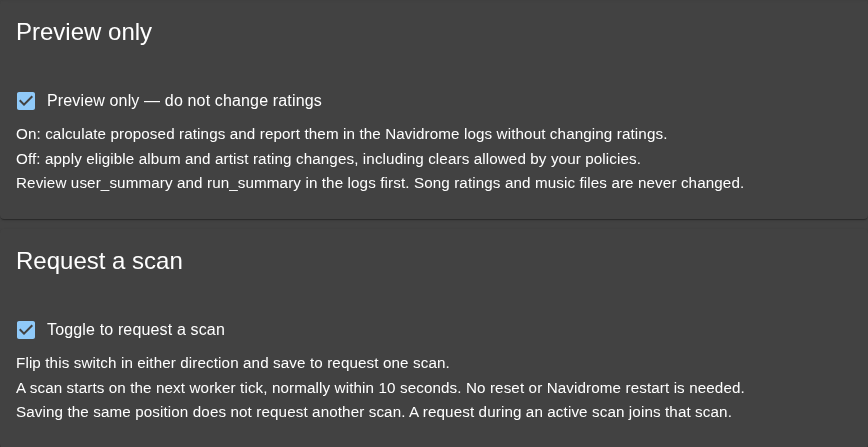
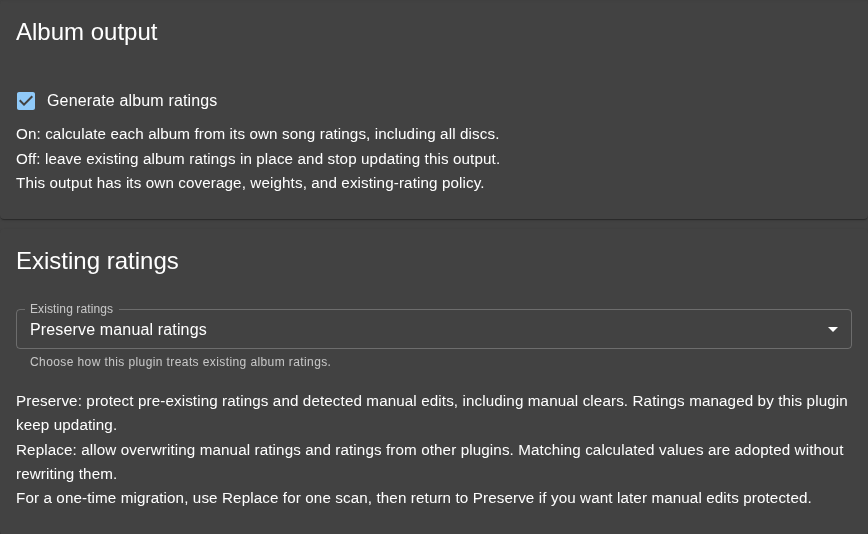
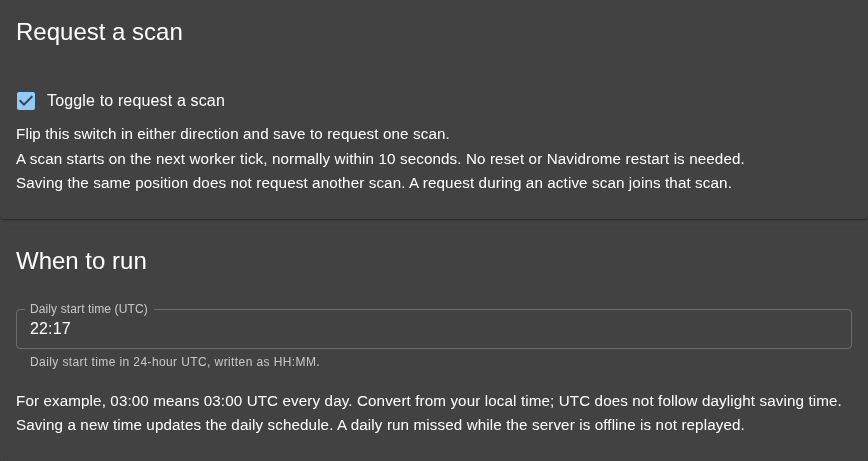

# Automatic Ratings for Navidrome

**Rate your songs. Let your album and artist ratings follow.**

Automatically calculate **album and artist ratings from each user's song ratings** in [Navidrome](https://www.navidrome.org/). Artist ratings come directly from songs, independently of album ratings. Song ratings and music files stay unchanged.

**[Download the plugin](https://github.com/JLS1996/navidrome-automatic-rating-plugin/releases/latest/download/automatic-ratings.ndp)** · [Configuration guide](docs/CONFIGURATION.md) · [Release notes](RELEASE_NOTES.md)

> [!IMPORTANT]
> **AI-assisted development**
>
> This plugin was developed with AI assistance. It is working well in the maintainer's current Navidrome setup.

*Actual Navidrome settings, captured with v0.4.1 in a fictional demo library.*

## Features

- **Independent outputs:** generate album ratings, artist ratings, or both.
- **Artist credits:** use album artists or each song's performing artists, including guests.
- **Your calculation:** customize star weights, exclude star levels, and require enough rated songs.
- **Manual rating protection:** preserve existing ratings and detected manual edits, or replace them when migrating.
- **Automatic or on demand:** run daily at your chosen UTC time, or flip the scan switch and save.

## Before you start

> [!CAUTION]
> **This plugin can change or clear album and artist ratings.**
>
> Back up your Navidrome database and plugin storage. Preview mode is on by default (`dry_run=true`): review `user_summary` and `run_summary` in the logs before turning it off and requesting another scan.
>
> The `replace` policy can overwrite manual ratings and ratings from other plugins. Disable older rating plugins before enabling writes.

## Installation

Requires **Navidrome 0.64.2 or newer** with native plugins enabled. No Node.js, Python, or source build is needed on your server.

1. Download **[automatic-ratings.ndp](https://github.com/JLS1996/navidrome-automatic-rating-plugin/releases/latest/download/automatic-ratings.ndp)**. A [SHA-256 checksum](https://github.com/JLS1996/navidrome-automatic-rating-plugin/releases/latest/download/automatic-ratings.ndp.sha256) is available; see [verification instructions](docs/OPERATIONS.md#verify-a-download).
2. Copy it into your Navidrome plugins directory and rescan plugins, or restart Navidrome so it appears.
3. Open **Automatic Ratings**, grant access to the intended **users and libraries**, and enable it.
4. Choose your settings and save. Settings apply without restarting Navidrome.

For upgrades, keep the filename and plugin storage so generated ratings stay recognized. See [upgrade instructions](docs/OPERATIONS.md#ownership-and-upgrades).

## Configuration

Each granted user gets separate results, using only libraries that both the user and plugin can access.

**General** contains preview, scan requests, the daily schedule, and artist credits. **Albums** and **Artists** each start with their output switch. **Extra** contains performance and logging.

| Setting | Default |
|---|---|
| Outputs | Albums and artists |
| Artist credits | Album artists |
| Required coverage | At least 30% of eligible songs and at least 1 rated song |
| Weights, from 1★ to 5★ | `1, 2, 3, 4, 5` — higher ratings have more influence |
| Existing ratings | Preserve manual ratings; refresh this plugin's output |
| Daily start time | **03:00 UTC** |

Set all five weights to `1` for a simple average, or use `0` to exclude a star level from scoring and coverage. One 5-star song and four 1-star songs produce **3 stars** with default weights, or **2 stars** with equal weights.

See Albums settings

Album and artist calculations have separate settings. See the [configuration guide](docs/CONFIGURATION.md) for examples and clearing rules.

## Running the plugin

Runs start daily at the configured time. For a scan now, flip **Toggle to request a scan** (`run_now`) in either direction and save. **No reset or Navidrome restart is needed.** If a scan is already running, the request joins it.

See the scan switch and schedule in General

## Help and development

[Operations and troubleshooting](docs/OPERATIONS.md) · [Technical reference](docs/REFERENCE.md) · [Audit and roadmap](docs/AUDIT.md)

[Report a bug or suggest a feature](https://github.com/JLS1996/navidrome-automatic-rating-plugin/issues). Include your Navidrome and plugin versions, relevant settings, and a log excerpt with private details removed.

To contribute, start with the [development instructions](docs/REFERENCE.md#build-and-benchmark).

## Credits and license

Inspired by [mattnic/navidrome-album-ratings](https://github.com/mattnic/navidrome-album-ratings). Released under the [MIT License](LICENSE).
